# Themes

<!-- Generated by scripts/theme_preview.py; run make previews after editing a theme. -->

Apply one with `make theme THEME=<name>`. Each preview shows light and dark mode.

## arctic

Muted frost blue with a soft orange accent. A calm Nordic look.

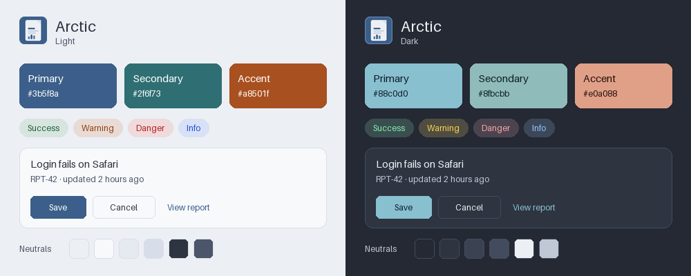

## contrast

Accessibility first: pure black text, strong borders, saturated status colors.

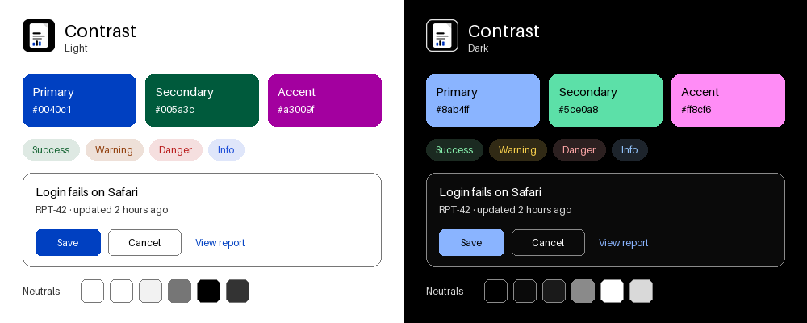

## ember

Burnt orange primary to match the logo, teal secondary, violet accent on warm grays. The default.

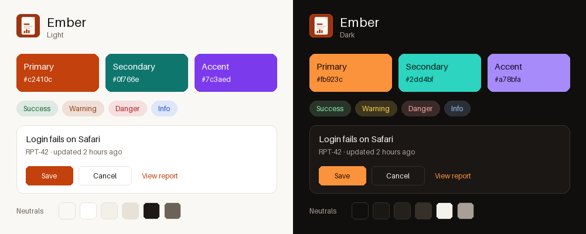

## forest

Emerald primary, indigo secondary, gold accent on cool grays.

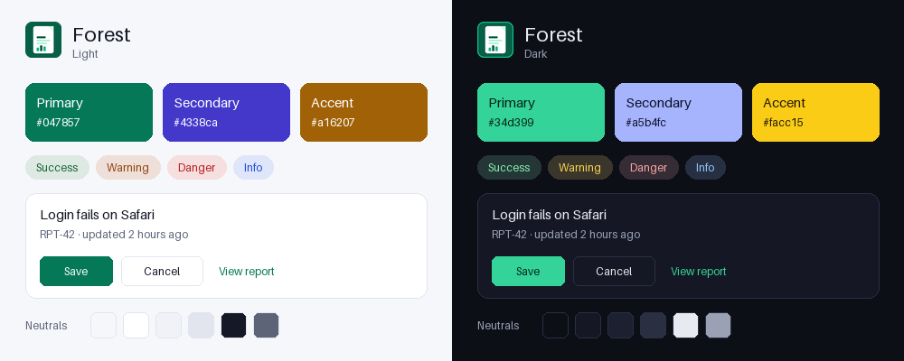

## grape

Violet primary, pink secondary, emerald accent on cool grays.

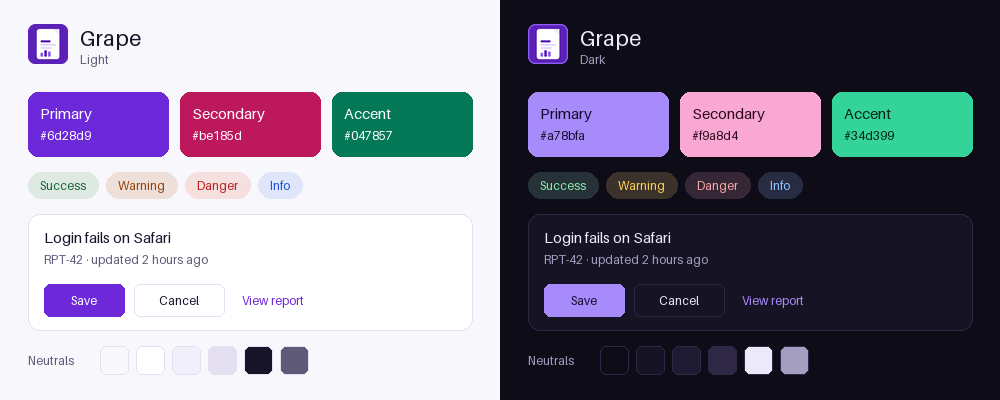

## graphite

Black and white with a blue accent. Minimal and high contrast.

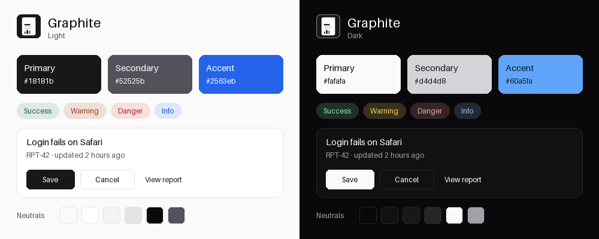

## indigo

Indigo primary, teal secondary, orange accent on cool grays.

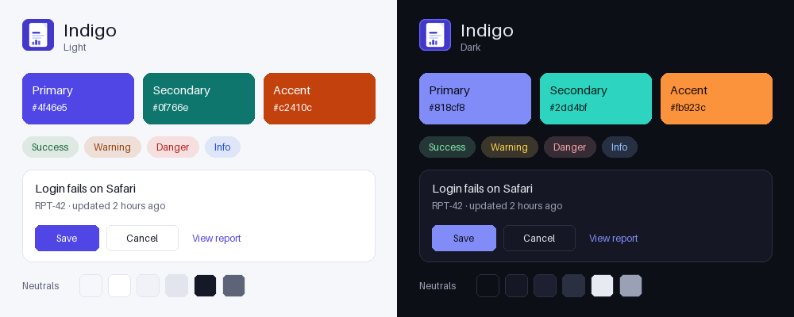

## matcha

Olive-green primary, teal secondary, terracotta accent on warm grays.

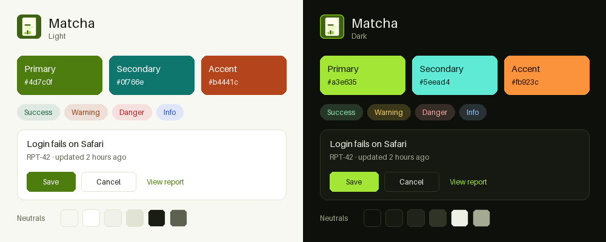

## midnight

Lavender light mode and deep navy dark mode with a cyan primary.

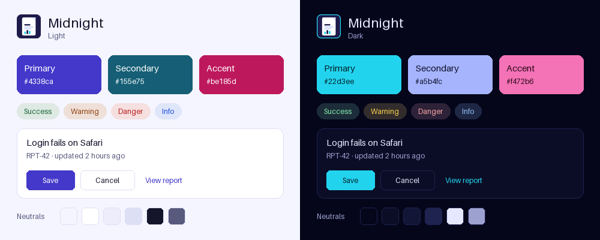

## ocean

Deep blue primary, cyan secondary, amber accent on cool grays.

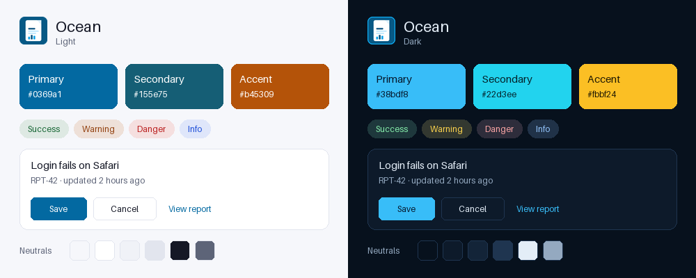

## rose

Rose primary, violet secondary, teal accent on blush grays.

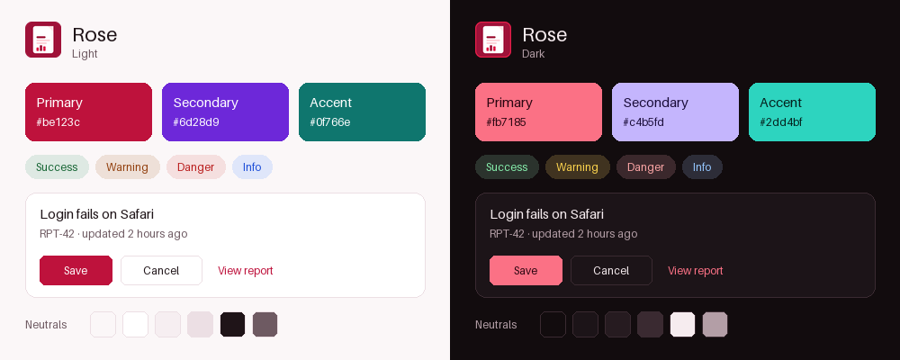

## sand

Blue primary, teal secondary, magenta accent on low-glare cream.

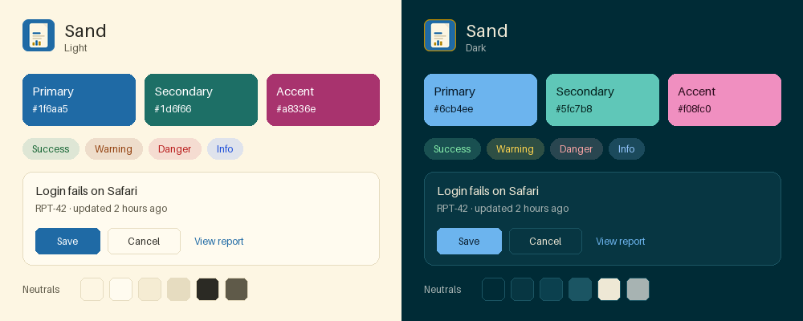

## slate

Near-monochrome slate primary, cyan secondary, rose accent.

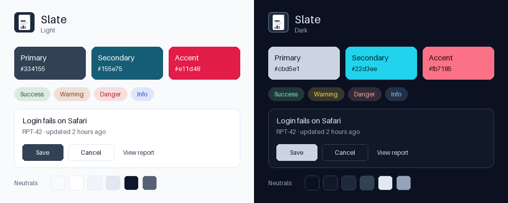

## sunrise

Amber primary, rose secondary, blue accent on sand.

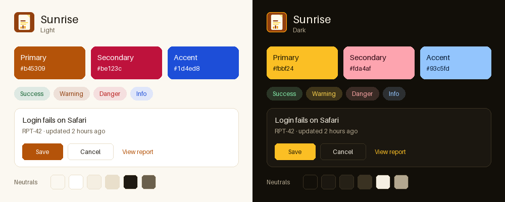
